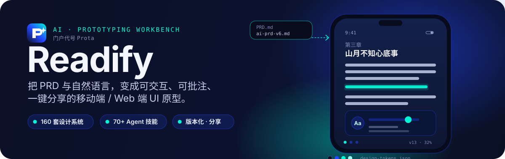
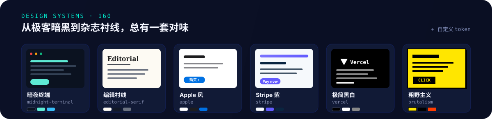
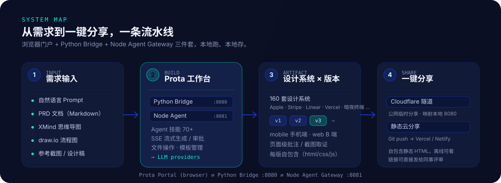

<p align="center">
  
</p>

> 一个跑在你自己电脑上的 **AI 原型工作台**。给它一段话、一份 PRD 或一张思维导图，它通过内置 Agent 直接生成可在手机框 / 浏览器里点击的原型，套用 **160 套现成设计系统**，按版本迭代，一键分享给同事评审。门户内代号 **Prota**。

---

## 它能做什么

<p align="center">
  
</p>

Readify 是一个 **本地优先** 的原型工作台。它不只是一个画图工具——AI Agent 会读你的需求文档，直接写出能跑、能点的 HTML/CSS/JS 原型页面，并把每一版原型、对应的 PRD、思维导图、流程图、批注都按「项目 → 页面 → 版本」的结构管理起来。

全新安装使用独立的空工作区，实际业务项目不会包含在产品仓库中。

## 为什么用它

| | 能力 | 说明 |
| --- | --- | --- |
| 🎨 | **160 套设计系统** | Apple、Stripe、Linear、Vercel、暗夜终端、编辑衬线、粗野主义……从 B 端到内容站，一键换肤 |
| 🤖 | **AI Agent + 70+ 技能** | 基于 Open Agent SDK，自然语言 / PRD 直接生成原型；支持生成 PRD、设计评审、截图取证等技能 |
| 📄 | **PRD 原生** | Markdown PRD 与原型双向绑定，页内可嵌 **XMind 思维导图** 与 **draw.io 流程图** |
| 🔢 | **版本化迭代** | `v1 → v2 → v3`，每版完全自包含，旧版保留不动，可随时回看对比 |
| 📱 | **双端** | `mobile` 手机端（手机外框模板）与 `web` B 端（Ant Design 风模板） |
| 📝 | **页面级批注** | 在原型上直接打点批注、截图取证，评审时所见即所议 |
| 🔗 | **两种分享** | Cloudflare 隧道（公网临时）/ 直接部署 Vercel（静态云） |
| 🏠 | **本地优先** | 文件、PRD、原型全部存在你自己的磁盘上，不依赖云服务 |

## 它是怎么工作的

<p align="center">
  
</p>

三件套协同：

- **Prota Portal（浏览器）** —— 工作台前端，负责页面编排、版本切换、PRD / 思维导图 / 流程图编辑、批注与分享入口。
- **Python Bridge `:8080`** —— 文件中枢。读写 `src/pages/`、管理 160 套设计系统模板、生成自包含静态分享页、独立静态发布。
- **Node Agent Gateway `:8081`** —— AI 执行器。基于 `@codeany/open-agent-sdk` 运行 Agent，加载 70+ 技能，通过 SSE 流式返回生成过程，敏感操作需你在工作台里审批。

一句话：**需求进 Portal → Agent 调技能写代码 → Bridge 落盘成版本化原型 → 一键分享**。

## 快速开始

**前置：** Node.js 22.9+、Python 3.9+、一个可用的 LLM（首次启动后在 Portal 里配置 provider）。

```bash
git clone https://github.com/lefinite/Prota.git
cd Prota
npm ci                 # 按锁文件安装 Agent SDK、Vercel CLI 等依赖
bash scripts/run.sh    # 启动 Bridge(:8080) + Agent(:8081)，并自动打开工作台
```

macOS 用户也可以直接**双击 `start-portal.command`**。

启动后浏览器会打开 `http://localhost:8080/portal/index.html`：

1. 在设置里配置 Agent 的 **LLM provider**（API Key 只存在本地，已被 `.gitignore` 忽略）。
2. 新建项目 → 新建页面（选 `mobile` 或 `web`）。
3. 把需求贴给 Agent，或写一份 PRD 让它照着做。
4. 如需云分享，先按[分享配置教程](docs/share-setup-guide.md)登录自己的 Vercel 账号并关联域名，再点「分享」。

Vercel CLI 是产品锁定的本地依赖，无需全局安装。在产品目录使用 `npm run vercel -- login` 登录、`npm run vercel -- --version` 查看版本。更新产品后执行 `npm ci` 并重新启动，CLI 随产品统一更新；工作区、登录和原分享项目继续保留。

> 只想公网临时演示？`bash scripts/start-public.sh` 会用 Cloudflare Tunnel 把本地 8080 映射到你的域名。这与静态云分享是两种发布方式。

## 项目结构

```
readifyapp/
├── portal/                # 浏览器工作台（前端 shell + 文档模块）
│   ├── agent/             #   Agent 客户端（SSE、provider 配置、会话）
│   └── modules/           #   prd / drawio / mindmap 文档模块
├── server/
│   ├── bridge.py          # Python Bridge :8080（文件 / 模板 / 分享）
│   └── agent-server.mjs   # Node Agent Gateway :8081（AI 生成）
├── src/
│   ├── pages/{项目}/{页面}/{版本}/   # 自包含原型：index.html + styles.css + app.js
│   └── templates/                    # 160 套设计系统 + 手机框 / Web 框
├── scripts/               # run.sh / start-public.sh / iterate.sh
├── data/                  # projects.json · templates.json · provider 配置
├── shares/                # 生成的自包含静态分享 HTML
├── tools/                 # drawio 主题审计、PRD 截图取证
└── docs/                  # 分享配置保姆级教程
```

## 核心概念

- **自包含页面** —— 每个版本目录自带 `index.html / styles.css / app.js`，**严禁跨版本引用**，保证旧版本永远可复现。每个原型都跑在独立 `<iframe>` 里，样式互不污染。
- **迭代版本** —— 说「迭代版本」时，系统复制当前最新版到下一版本号（`v2 → v3`），只在新版上改，旧版原样保留。命令行可用 `bash scripts/iterate.sh <project> <page> <new_version>`。
- **设计系统** —— `src/templates/design-systems/` 下每套系统包含 `DESIGN.md`、design tokens、组件示例。Agent 生成时按你选的系统落地配色与排版。
- **PRD 与原型绑定** —— PRD 存在页面层级的 `docs/` 目录，分享时会把当前 PRD、批注、相关文档一起打进静态页，评审者看到的是「带需求说明的原型」。

## 两种分享方式

| 方式 | 原理 | 适合 |
| --- | --- | --- |
| **公网临时分享** | Cloudflare Tunnel 把本地 `:8080` 映射到你的域名 | 快速演示、不提交代码 |
| **静态云分享** | 生成独立静态发布包，直接部署到 Vercel | 长期存档、发链接给客户 |

分享页面内嵌所选 PRD 与批注，原型及必要资源随发布包部署。下载包可用于离线保存。

## 技术栈

- **前端** 原生 JS Shell + 模块化（PRD 渲染、draw.io 集成、React 19 思维导图编辑器，零运行时 CDN）
- **AI** `@codeany/open-agent-sdk` + 自定义 70+ Agent 技能
- **后端** Python（Bridge，文件与模板）+ Node.js（Agent Gateway，SSE 流式）
- **分享** Cloudflare Tunnel / Vercel 直接部署
- **思维导图** `@xiangfa/mindmap`（预览走纯函数 SVG，编辑器走预打包的 React bundle）

## 状态

个人 / 团队原型工作台，持续迭代中。业务内容与产品代码独立保存。

## 工作区与开源发布

业务页面、PRD、会话及附件独立于程序保存；静态分享通过 Vercel 直接部署，不推送业务数据到 GitHub。配置与迁移方法见 [工作区与直接分享部署](docs/workspace-and-publishing.md)。
