<p align="center">
  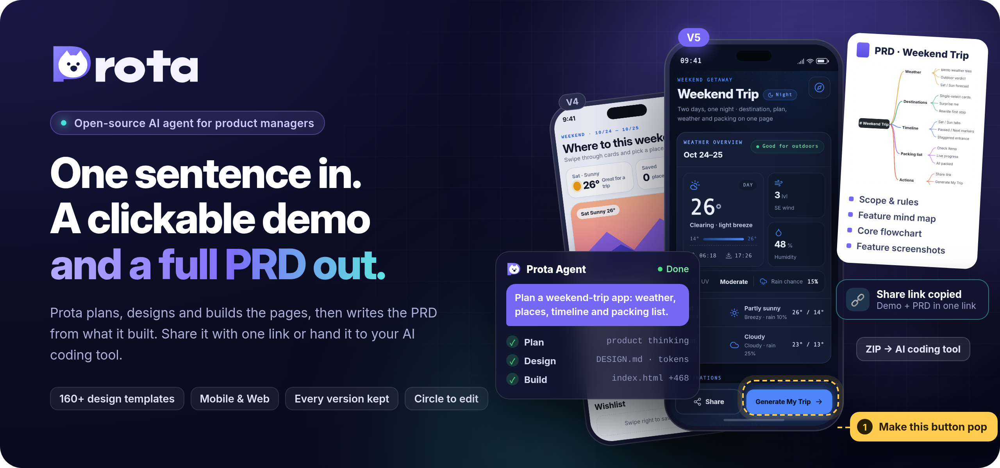
</p>

<p align="center">
  <b>English</b> · <a href="./README.zh-CN.md">简体中文</a>
</p>

https://github.com/user-attachments/assets/da40f189-605c-4f6a-873c-5cc17df73118

## Got an idea?

**Prota is an AI agent built for product managers.** Describe a product idea in one sentence. Prota designs and builds the pages, gives you a working prototype in minutes, and then writes the complete PRD from what it built. Share it with one link, or hand it to your AI coding tool as context.

It runs on your own computer and uses your own model API.

```txt
Idea  →  Clickable demo  →  Complete PRD  →  Share link  →  Hand-off to AI coding tools
```

## The tour, step by step

### 1. Start from 160+ design templates

Pick one of 159 design systems for mobile or one of 9 Web component frameworks (Ant Design, Arco, Chakra UI, Element Plus, Mantine, Material UI, Semi, shadcn, TDesign) and start building. Each design system comes with its own `DESIGN.md` and tokens, so the agent follows a real visual language instead of making one up.

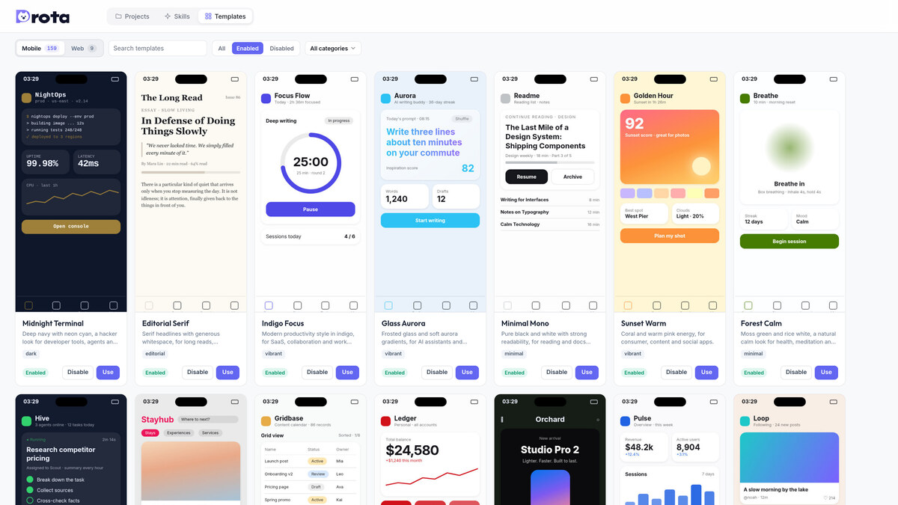

### 2. Built-in product skills

The agent ships with skills for the PM workflow: **Product thinking** (Plan mode breaks the idea down before building), **Page design** (`create-new-page`), **Flowcharts** (`generate-flow-diagram`, editable draw.io) and **PRD generation** (`generate-prd`). There are also design-quality skills for frontend craft, minimalist UI, high-end visuals and redesigns. You can add, enable or remove skills from the home screen.

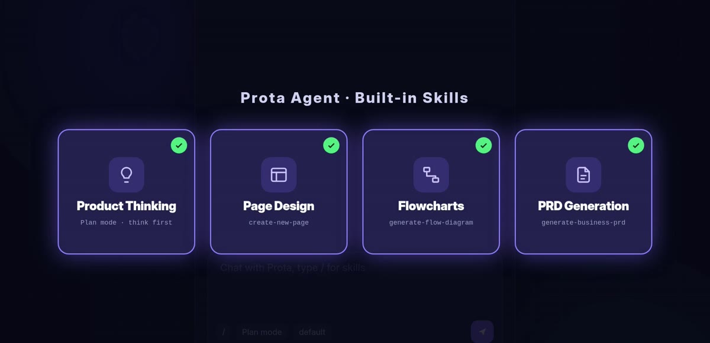

### 3. One sentence in, a working prototype out

Describe the idea. Prota plans, designs and writes the page (`index.html`, `styles.css`, `app.js`), checks the code, and shows the live result in a phone or Web frame. You can see every step it takes.

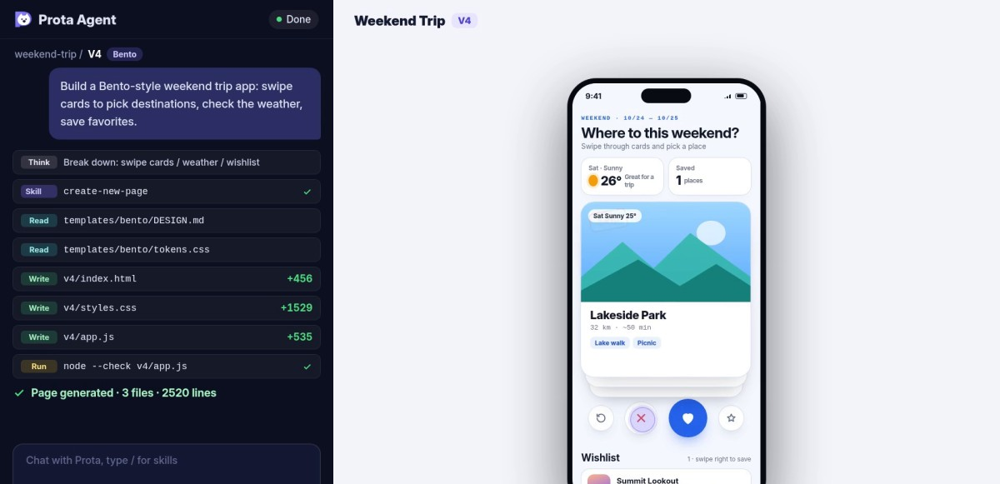

### 4. Try bolder ideas: every version is kept

Start a new version whenever you want to try a different direction. Versions are self-contained folders (`v1`, `v2`, …). Older ones are never overwritten, so you can switch back and compare at any time.

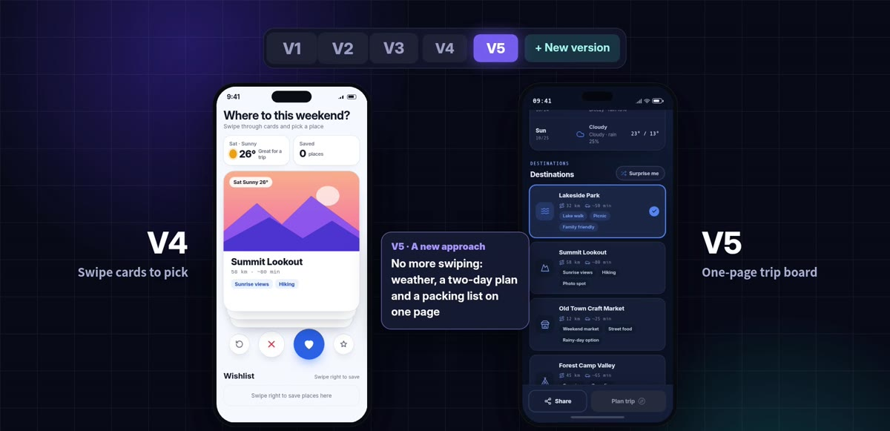

### 5. Circle it, leave a note, and only that part changes

Turn on annotation mode, circle the element you don't like and write what you want. Prota edits only that area and leaves the rest of the page untouched.

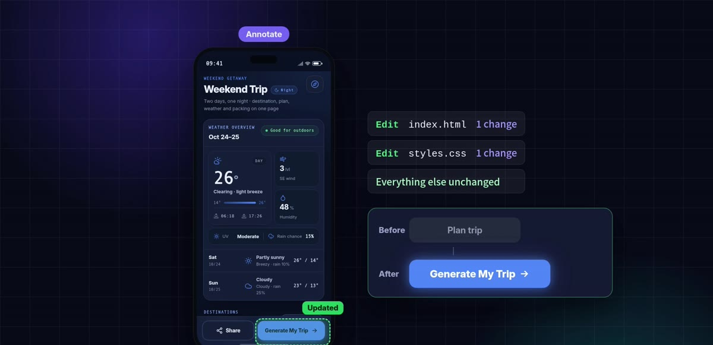

### 6. Generate the PRD in one click

When you're happy with the prototype, Prota writes a PRD from your prompts, your annotations and the actual source code. It includes product logic and scope, feature specs and rules, a feature mind map, the core flowchart, and a screenshot for every feature.

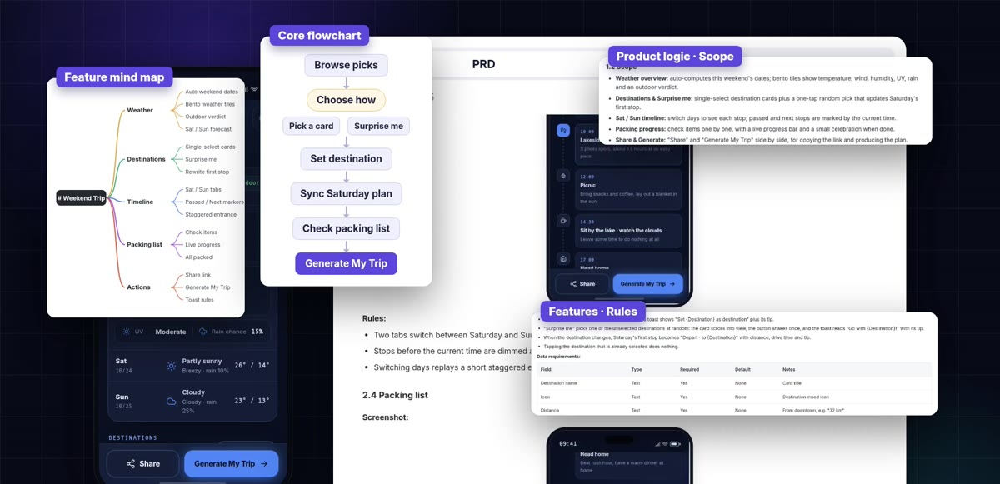

### 7. Share with one link

Share a page or a whole folder. Prota builds a static share page: teammates can try the demo and read the docs in the browser, and your computer doesn't need to stay online.

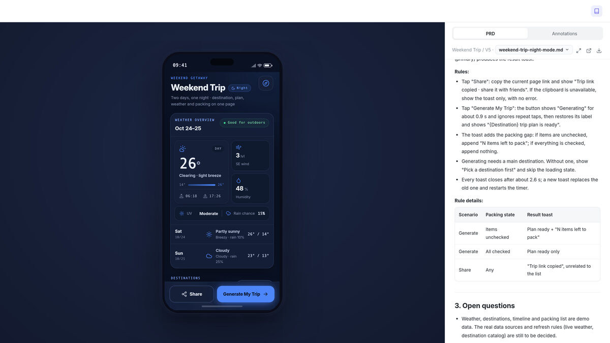

### 8. Hand it to your AI coding tool

From the share page, developers can download a ZIP of the prototype and the PRD and give it to their AI coding tool as context, so it knows exactly what to build.

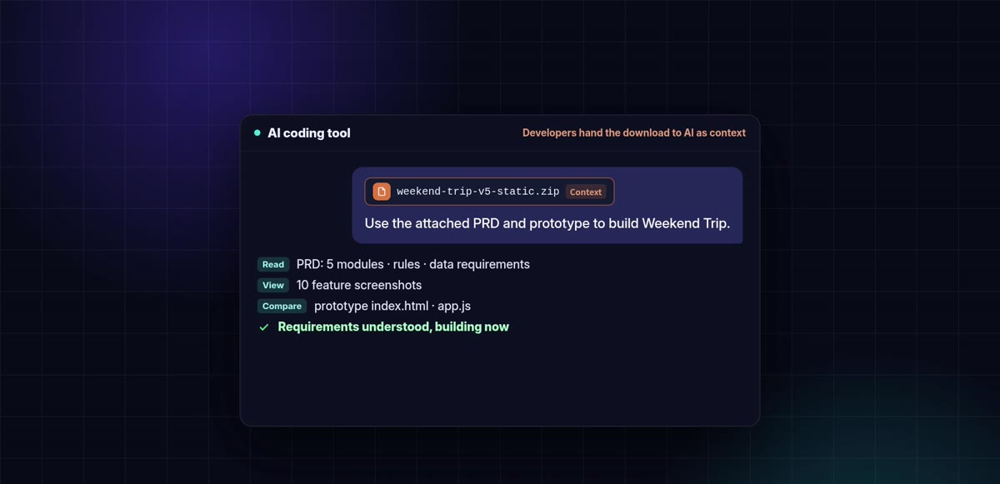

## How it works

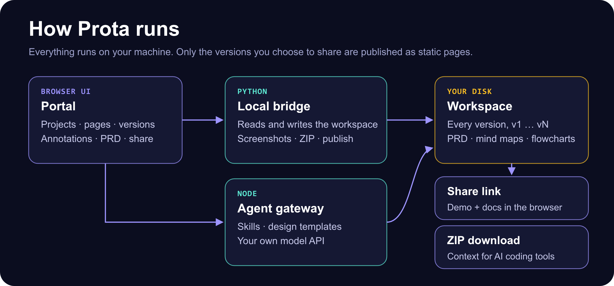

| Part | What it does |
| --- | --- |
| `portal/` | The browser app: projects, pages, versions, annotations, PRD viewer, mind maps, draw.io diagrams and settings |
| `server/bridge.py` | Local bridge: serves the Portal and reads or writes the workspace. Also handles screenshots, ZIP packaging and publishing |
| `server/agent-server.mjs` | Agent gateway: runs agent sessions with skills, design templates and the model you configure |
| `src/templates/` | Mobile and Web frames, 159 design systems and 9 Web framework templates |
| `.claude/skills/` | The built-in skills listed above |

Your projects live in a **workspace** separate from the app. By default it's `~/.config/prota/workspace`. You can move it or open another one in **Settings → Storage**, or set `READIFY_WORKSPACE`.

## Quick start

Download and extract the complete product folder, then double-click **Prota.app on Mac** or **Prota.exe on Windows**. Keep the entry beside the source folders; do not run it inside the ZIP archive. Missing runtimes and dependencies are prepared automatically with a native progress window; when everything is ready, the Portal opens directly. No terminal commands or terminal window are needed. Supported systems: macOS, Windows 10/11 x64, and Windows 11 ARM64.

For cloud sharing, click **Connect Vercel** in Settings and authorize in your browser. Prota creates or reuses the sharing project and saves its address automatically. Existing data and sharing links are retained. A custom domain is optional; DNS records at an external provider still require your action.

[Startup and sharing guide](./docs/share-setup-guide.md) · [Developer setup](./docs/developer-setup.md)

1. **Connect a model:** click the gear icon in the top-right of the project list and go to **Settings → Models**. Pick a preset or choose *OpenAI-compatible / custom*, then enter your API key. Both Anthropic Messages-style and OpenAI-compatible APIs are supported.
2. **Create a project and a page** (mobile by default, Web if you ask for it), pick a design template, and describe your idea.
3. **(Optional) Turn on sharing:** set up static sharing in **Settings → Sharing**. See [docs/share-setup-guide.md](./docs/share-setup-guide.md) for how publishing works and what gets uploaded.

## Good to know

- The Portal interface and the generated PRDs are currently in **Chinese**. The prototypes themselves can be in any language you ask for.
- Shared pages include the selected versions and their documents, and nothing is redacted automatically. Check the content before you share.
- Your model API key and personal settings stay on your machine and are never included in shares.

## Development

```bash
npm run agent:check              # syntax-check the agent gateway
node --test tests/*.test.mjs     # Node tests
python3 -m unittest discover -s tests -p "test_*.py"   # Python tests
```

Project conventions for agents (directory layout, versioning, page registration) are in [AGENTS.md](./AGENTS.md).

## License and acknowledgments

Prota is available under the [MIT License](./LICENSE). You may use, modify, distribute and sell it, including in closed-source products, provided you retain the copyright and license notice identifying [Prota by lefinite](https://github.com/lefinite/Prota) as the original project.

Many of the design templates are sourced or adapted from [OpenDesign](https://github.com/nexu-io/open-design); thanks to its creators. Third-party templates, assets and dependencies remain subject to their respective licenses and notices.

---

<p align="center">From idea to delivery. <b>Prota helps great ideas ship faster.</b></p>

<p align="center">If Prota helps you, consider sponsoring a few tokens.</p>
<p align="center">
  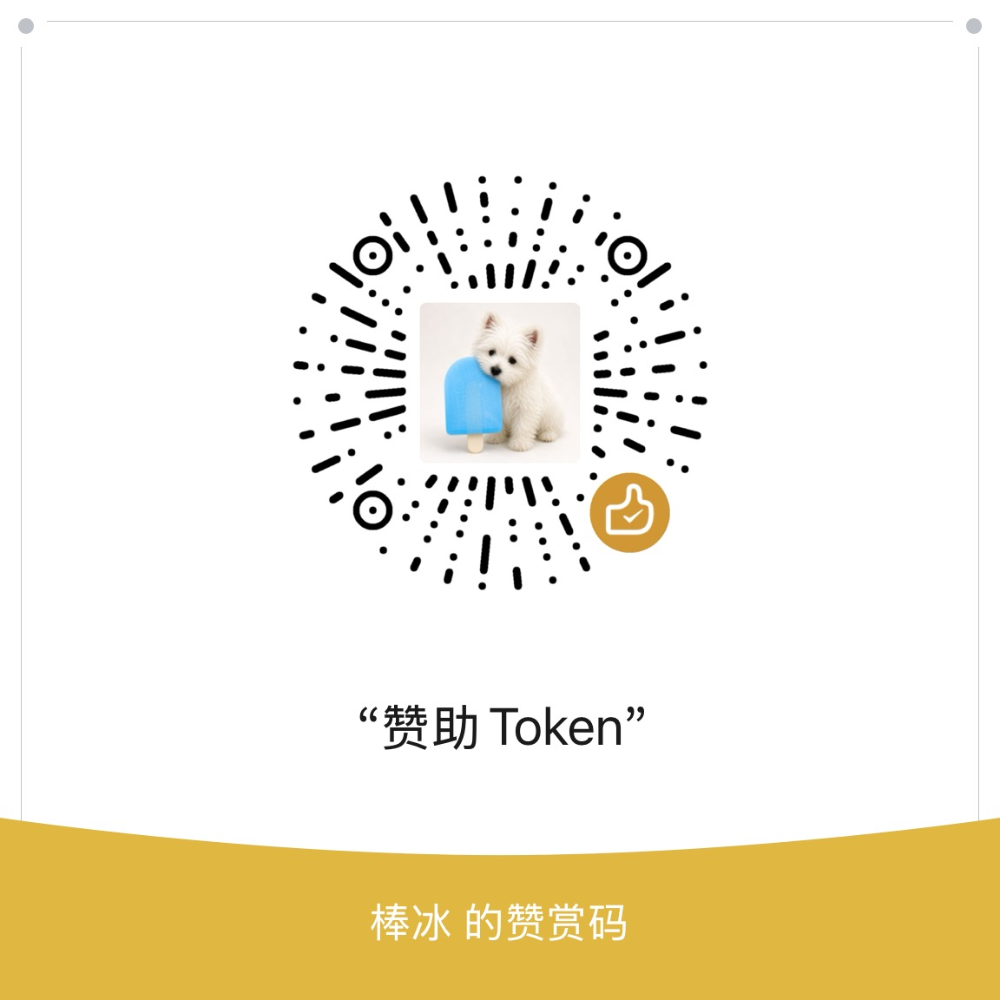
</p>
