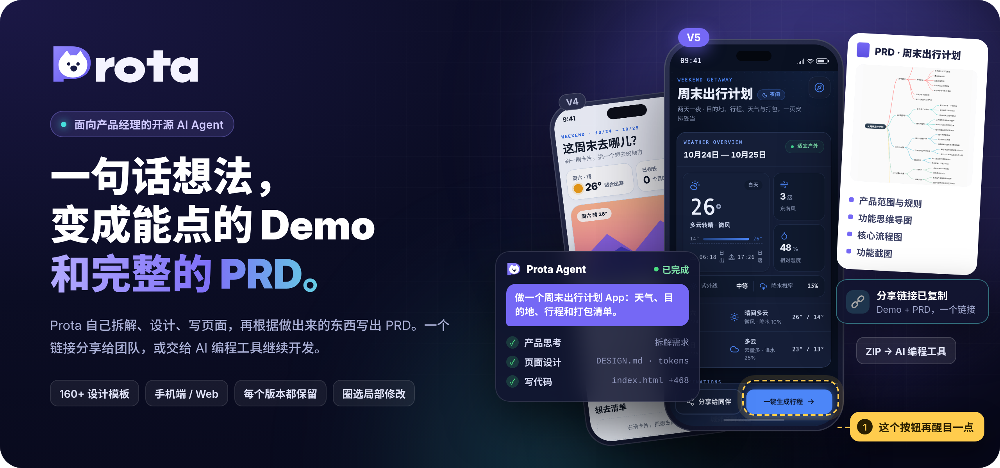
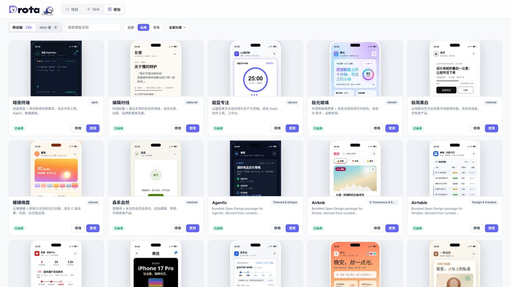
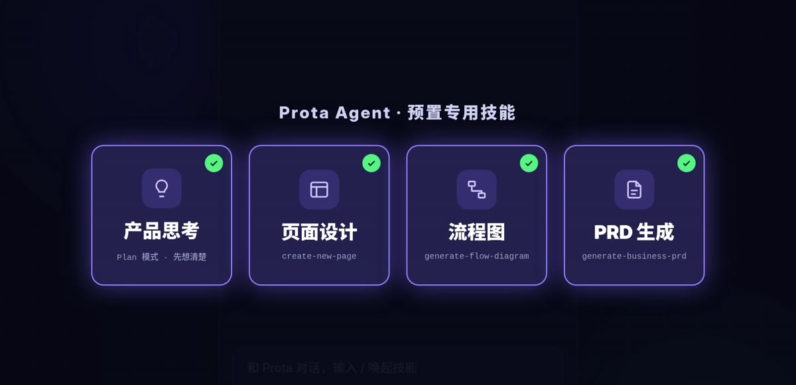
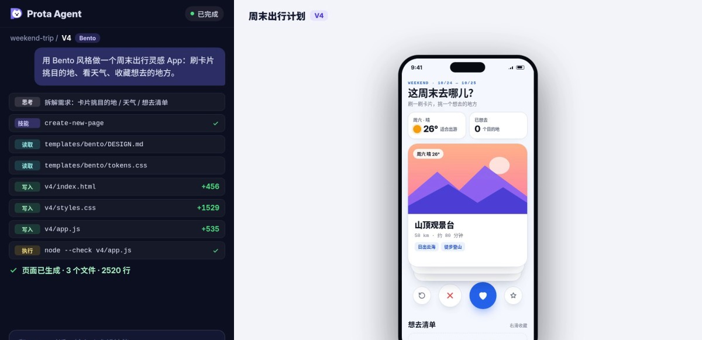
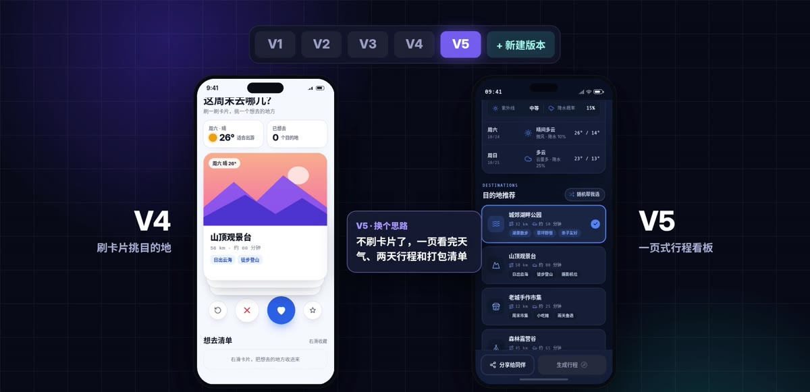
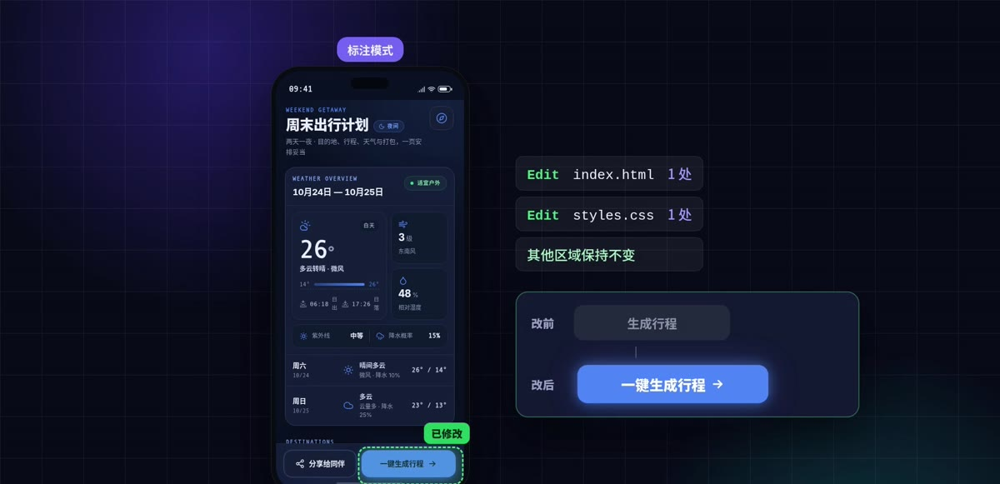
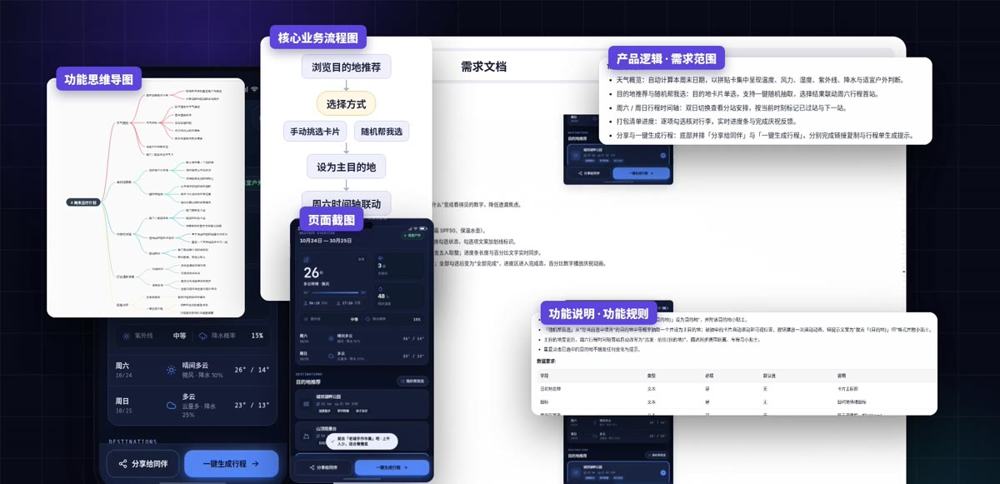
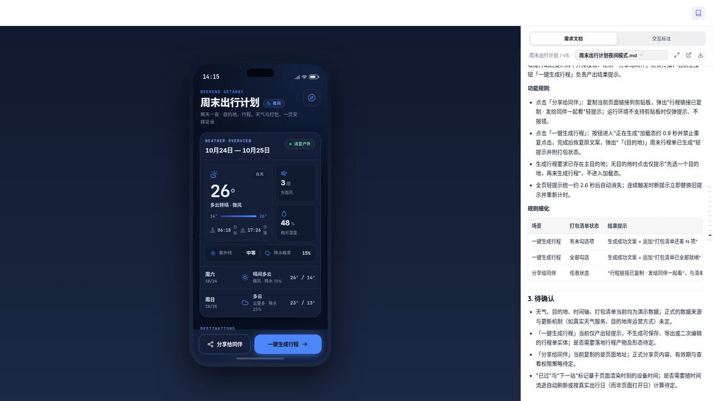
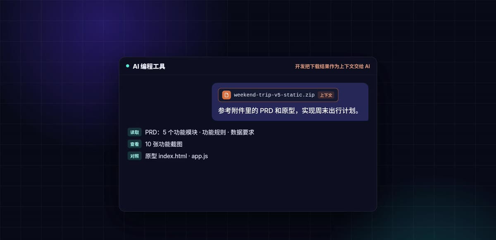
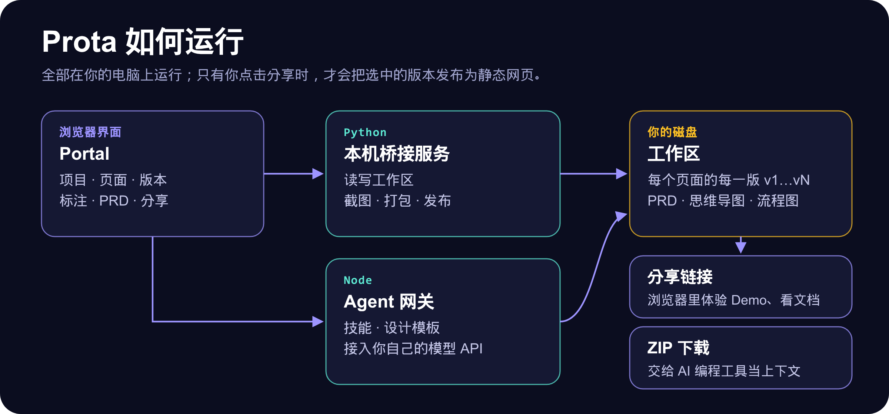

<p align="center">
  
</p>

<p align="center">
  <a href="./README.md">English</a> · <b>简体中文</b>
</p>

https://github.com/user-attachments/assets/59b01f3c-72c1-432c-b82e-086f7889fe38

## 一个想法，怎样最快变成 Demo，再变成完整的交付物？

**Prota 是专为产品经理打造的 AI Agent。** 你用一句话说出想法，它会自己拆解、设计、写页面，几分钟后交给你一个能直接体验的原型，再根据做出来的东西写出完整的 PRD。写好后发一个链接就能分享，也可以交给 AI 编程工具继续开发。

Prota 在你自己的电脑上运行，使用你自己的模型 API。

```txt
想法  →  能点的 Demo  →  完整 PRD  →  分享链接  →  交给 AI 编程工具
```

## 跟着视频走一遍

### 1. 内置 160 多套设计风格模板

手机端有 159 套设计风格，Web 端有 9 套组件框架模板（Ant Design、Arco、Chakra UI、Element Plus、Mantine、Material UI、Semi、shadcn、TDesign），挑一套就能开工。每套设计风格都带有自己的 `DESIGN.md` 和设计变量，Agent 会照着真实的视觉规范来做，而不是自己随便发挥。



### 2. 预置产品经理专用技能

Agent 预置了产品经理工作流需要的技能：**产品思考**（Plan 模式，先拆解再动手）、**页面设计**（`create-new-page`）、**流程图**（`generate-flow-diagram`，生成可编辑的 draw.io）和 **PRD 生成**（`generate-prd`）。另外还有前端设计、极简风格、高级视觉、改版等设计类技能。技能可以在首页添加、启用或删除。



### 3. 一句话进去，可体验的原型出来

说出想法，Prota 会规划、设计并写出页面（`index.html`、`styles.css`、`app.js`），检查代码，然后在手机或 Web 外框里展示实际效果。它做的每一步你都能看到。



### 4. 大胆去试，每一版都保留

想换个思路时，就新开一个版本随便改。每个版本都是独立的目录（`v1`、`v2`……），旧版本不会被覆盖，随时可以切回去对比。



### 5. 圈出来写一句，只改你指的地方

打开标注模式，在页面上圈出不满意的地方，写一句要怎么改。Agent 只改这一处，其他地方保持不变。



### 6. 方案定了，一键生成 PRD

原型满意了，Prota 会结合你的需求描述、标注和真实源码写出 PRD。里面有产品逻辑与需求范围、功能说明与规则、功能思维导图、核心流程图，每个功能的页面截图也都配好了。



### 7. 分享只需要一个链接

可以分享单个页面或整个文件夹。Prota 会生成静态分享页，团队和开发打开链接就能体验 Demo、查阅文档，你的电脑不需要一直开着。



### 8. 交给 AI 继续开发

开发人员可以在分享页一键下载原型和 PRD 的 ZIP 包，直接作为上下文交给 AI 编程工具，让 AI 准确理解产品需求。



## 运行原理



| 部分 | 作用 |
| --- | --- |
| `portal/` | 浏览器端应用：项目、页面、版本、标注、PRD 阅读、思维导图、draw.io 流程图和设置 |
| `server/bridge.py` | 本机桥接服务：提供 Portal 页面，读写工作区，并负责截图、打包和发布 |
| `server/agent-server.mjs` | Agent 网关：用技能、设计模板和你配置的模型运行 Agent 会话 |
| `src/templates/` | 手机端与 Web 端外框、159 套设计风格、9 套 Web 框架模板 |
| `.claude/skills/` | 上面介绍的预置技能 |

你的项目保存在与程序分开的**工作区**里，默认位置是 `~/.config/prota/workspace`。可以在 **设置 → 存储位置** 里迁移或打开其他工作区，也可以用环境变量 `READIFY_WORKSPACE` 指定。

## 快速开始

macOS 用户下载并解压完整产品文件夹，双击 **Prota.app**。请保留应用入口与源码目录的相对位置。缺少环境或依赖时，原生窗口会显示准备步骤并自动安装；都已就绪时直接打开工作台，无需输入命令，也不需要保留终端窗口。

云分享只需在设置里点击「连接 Vercel」，然后在浏览器中登录授权。Prota 会自动创建或沿用分享项目、获取地址并保存，保留现有数据与分享链接。默认地址不需要购买域名；自有域名托管在其他服务商时，仍需按提示添加 DNS 记录。

[启动与分享教程](./docs/share-setup-guide.md) · [开发者安装说明](./docs/developer-setup.md)

1. **接入模型：** 点击项目列表右上角的齿轮，进入 **设置 → 模型配置**。选择一个预设服务商，或者选「OpenAI 兼容 / 自定义」，填入 API Key。支持 Anthropic Messages 格式和 OpenAI 兼容格式的接口。
2. **新建项目和页面**（默认是手机端，需要时可以指定 Web 端），选一套设计模板，然后用一句话描述你的想法。
3. **（可选）开启分享：** 在 **设置 → 分享配置** 里完成静态分享的设置。发布流程和上传内容见 [docs/share-setup-guide.md](./docs/share-setup-guide.md)。

## 使用须知

- 分享会包含所选版本及其文档，不会自动脱敏，分享前请检查内容。
- 模型 API Key 和个人设置只保存在本机，不会出现在分享内容里。

## 开发

```bash
npm run agent:check                                   # 检查 Agent 网关语法
node --test tests/*.test.mjs                          # Node 测试
python3 -m unittest discover -s tests -p "test_*.py"  # Python 测试
```

给 Agent 的项目规约（目录结构、版本迭代、页面注册）见 [AGENTS.md](./AGENTS.md)。

## 开源协议与致谢

Prota 采用 [MIT 协议](./LICENSE)，允许自由使用、修改、分发、商用及闭源使用，只需保留版权与许可声明，其中注明了原始项目为 [lefinite 的 Prota](https://github.com/lefinite/Prota)。

项目中的许多设计模板来自或改编自 [OpenDesign](https://github.com/nexu-io/open-design)，感谢原作者的分享。第三方模板、素材及依赖仍遵循各自的许可证与署名要求。

---

<p align="center">从想法到交付，<b>Prota，让好想法更快落地。</b></p>

<p align="center">如果 Prota 对你有帮助，欢迎赞助一点 Token。</p>
<p align="center">
  
</p>
