# 静态云分享配置与数据链路

## 点击分享后发生什么



1. Portal 向本机服务发送分享请求，指定项目、页面和版本；文件夹分享则包含所选页面。
2. 本机服务从独立业务工作区读取内容，生成静态分享 HTML。单页分享同时生成 ZIP 下载包。当前实现会包含页面的标注、PRD 等文档内容。
3. 发布器复制上次成功发布的静态快照，再叠加本次分享选中的版本目录、页面文档、引用素材和分享产物。其他页面保留上次已发布的内容，不同步本次未选中的本地修改。
4. 发布器在本机用户配置目录下创建独立临时目录，按 Vercel Build Output API v3 组织为 `.vercel/output/static`，调用产品内部已安装的 Vercel CLI，使用本机登录凭据执行 `deploy --prebuilt --prod --yes --cwd <临时目录>`。
5. Vercel 创建生产部署，原项目的分享域名指向新部署。部署成功后，本机更新发布快照并返回分享链接。访问者从 Vercel 读取静态文件，无需你的电脑保持在线。

GitHub 只维护产品代码，不参与这条分享链路。产品私有仓库的状态不会影响已经部署的分享。

## 实际发布范围

发布的是组合后的完整静态输出，包括以前已经发布的分享和本次分享内容。每个选中页面按整个版本目录复制，并包含页面文档目录以及被引用的素材、模板；单页 ZIP 也包含该版本与文档。它并非只有截图或当前 HTML。

项目总索引、Agent 会话、个人设置、模型连接配置和原始附件目录不会作为目录整体发布。但是写进页面或文档的内容、被原型引用的素材仍会上传，不会自动脱敏。分享前应检查选中版本及文档是否适合按当前链接权限展示。

首次没有 `data/published-static` 快照时，会导入工作区中已生成的所有 `*-static.html` 分享。因此不要把“本地生成过”直接等同于“此前已成功发布过”。本地快照保存在业务工作区，不进入产品仓库。

每次发布都会新增 Vercel 部署；程序不会自动清理平台历史版本。本地删除页面也不会自动撤回快照里已发布的内容。撤回分享和清理历史需单独处理，并核对仍在使用的链接。

## CLI 安装与动态更新

用户在产品安装目录执行 `npm ci`（或 `npm install`）安装产品依赖时，`postinstall` 会自动从 npm 仓库获取 `vercel@latest`，即安装时 `latest` 标签对应的版本。Vercel CLI 不再固定在某个产品版本上。

CLI 安装在产品内部的 `node_modules/.prota-vercel/`，与其他产品依赖的锁文件分开管理。依赖声明位于 `tools/vercel-runtime/package.json`；安装目录不进入 Git 仓库。这样即使下载的是较早发布的产品源码，安装时仍会查询当时的最新版 CLI，不受旧 `package-lock.json` 限制。安装需要网络；若失败会报错，不会静默使用旧版冒充安装成功。

登录、项目初始化和实际分享使用同一个产品入口：

```sh
npm run vercel -- --version
npm run vercel -- login
```

从业务工作区或其他目录操作时，使用 `node "/绝对路径/产品安装目录/scripts/vercel-cli.mjs" login` 等价调用；脚本自动定位产品依赖，不依赖当前目录。产品不会使用全局 CLI 或任意 npx 缓存。缺失或安装不完整时会停止发布并提示修复。

每次分享直接使用已经安装的 CLI，不会现场检查升级。以后想单独更新 CLI，可在产品安装目录运行：

```sh
npm run vercel:update
```

重新安装产品依赖也会获取当时最新版，不需要等维护者修改固定版本号。启动器发现依赖缺失时，会自动安装依赖；已有完整安装时正常启动，不会每次联网升级。更新不会修改业务工作区、分享项目、域名或原链接。

如果主动用 `--ignore-scripts` 跳过安装脚本，需要再执行 `npm run vercel:update` 安装 CLI。最新版可能改变命令或登录行为；产品应持续验证兼容性，安装及发布失败都应明确报告。

## 已有分享项目

已有项目和域名可继续沿用，无需重建。仅在登录失效或更换账号、团队、域名时重新关联。

1. 在产品安装目录执行 `npm ci`（会自动安装当时最新版 CLI），然后执行 `npm run vercel -- login`，完成本机登录。已有有效登录可沿用。
2. 确认分享域名已绑定到预期 Vercel 项目，且该项目属于当前登录账号可访问的团队。
3. 从产品安装目录运行：

   ```sh
   python3 scripts/configure-vercel.py --domain share.example.com
   ```

   从其他目录运行时，使用脚本的绝对路径。Agent 的当前目录通常是业务工作区，不能直接使用上面的相对路径。该脚本只发现并关联现有项目，不创建项目，也不修改 DNS。
4. 在产品「设置 → 分享」填写相同域名，开启「生成后自动部署到 Vercel」并保存。
5. 用允许分享的页面验证部署成功和链接可访问，再复制链接。只生成本地文件或出现部署失败提示，都不代表线上已更新。

本地 `vercel.json` 只保存项目 ID、团队 ID、项目名和域名。登录凭据由 Vercel CLI 在用户目录中管理，不写入产品仓库。

## 首次创建分享项目

1. 登录 Vercel 后，准备一个独立空目录，只放空白 `index.html`。在产品安装目录执行 `npm run vercel -- deploy --cwd /绝对路径/空白分享目录`，按提示创建分享项目。这里的 `--cwd` 必须指向该空白目录，不能省略，也不能指向产品安装目录或业务工作区。
2. 在项目 **Settings → Domains** 添加分享域名，按 Vercel 控制台给出的 DNS 记录完成验证。
3. 按上节将域名对应项目关联到产品，保存设置并验证一次分享。

无需导入 GitHub 仓库，也不需要把 Output Directory 设置为 `shares`；产品使用独立的预构建静态输出。

「让 Prota 帮我配置」会把配置指令放入输入框，需要确认后发送。网页登录及域名验证仍需在自己的账号中完成。

## 原链接与旧 Git 部署

产品同时保留 `/shares/文件名.html` 和 `/文件名.html` 路径。只要继续使用同一项目、域名及文件名，现有链接可延续。需要更新内容时重新分享对应页面。

直接部署验证完成后，若旧项目仍连接 Git 仓库，应断开 Git 关联，避免后续 Git 部署覆盖直接发布。配置过程不需要删除现有分享或历史部署；历史资料清理属于另一项操作，应先备份、核对链接再处理。

官方参考：[预构建和生产部署](https://vercel.com/docs/cli/deploy)、[CLI 项目关联](https://vercel.com/docs/cli/project-linking)、[通过 CLI 部署项目](https://vercel.com/docs/projects/deploy-from-cli)。
