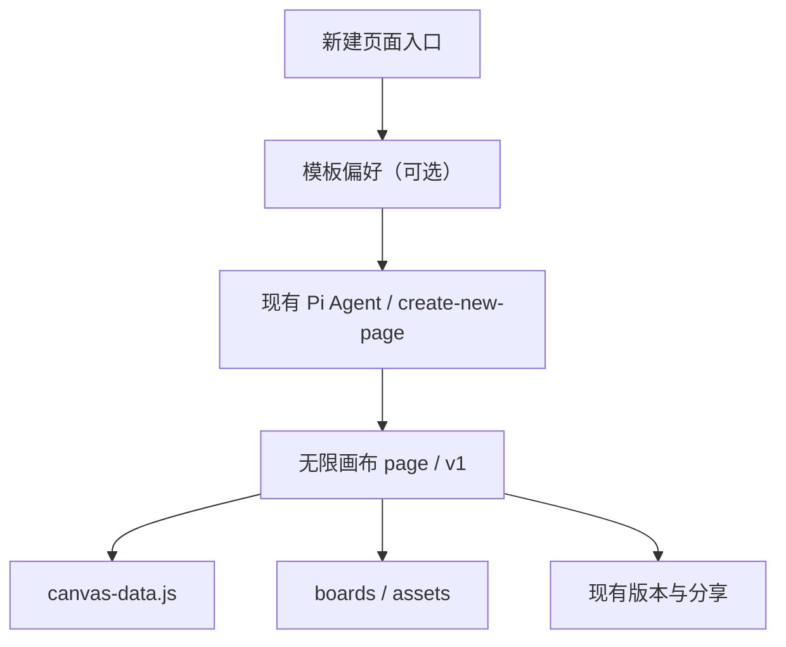

# Prota 新建页面统一无限画布：产品方案与技术执行方案

> 2026-11-05 · 实施目标：统一**新建入口**，保留历史页面及现有画布 Runtime。对应代码分支 `feat/unified-infinite-canvas-creation`。

## 1. 目标和边界

把原来的「智能 / 自由 / 手机 / Web / 无限画布」五选一，收敛为一个**新建页面 → 无限画布**入口。无限画布是容器，不是业务设计的设备类型。Agent 根据语义和上下文判断内部画板应该是手机 H5、桌面 Web、自定义尺寸，或在同一画布中混排。

本次要达到：

1. 新页面默认 `targetDevice: "canvas"`、`pageMode: "infinite-canvas"`。
2. 单界面按单画板生成，跨端/多步骤流程按需生成多个画板，互不影响。
3. 统一入口继续使用全部已有视觉风格和 Web 框架模板，支持不选模板。
4. 保留现有 Pi Agent、无限画布编辑、自动保存、画板版本、PRD、标注、分享、Vercel、ZIP 等路径。
5. 历史 `mobile` / `web` / 旧 `canvas` 和原有无限画布一律保留原貌。

**不做的事**：不改已有业务版本、不批量转换历史页面、不引入第二套 Agent、不重写画布 Runtime、不建立独立模板后台、不强制 Agent 的实现框架、不改发布入口与分享权限功能。

## 2. 交互方案

### 2.1 新建入口

现有「新建页面」仍打开 Agent Workbench，提示文本输入区不变。底部状态区域显示：

`无限画布`（不可切换的说明） · `模板：智能选择 ▾` · `＋ 空白画布`

移除端类型 `select`；不再让用户在手机、Web、自由画布、智能与无限画布之间做产品架构决策。

- **默认**：智能选择。Agent 不受模板约束，按需求生成。
- **模板选择**：同一个弹出层按「智能创作 / 视觉风格 / Web 框架」分组，使用已有图片、名称与预览。每次只选一种设计参考，点击即选中。切换不会清空用户已输入的需求。
- **空白画布**：保留已有跳过 Agent 的快捷创建；无论当前选了什么模板，都创建空白无限画布，模板不会暗中注入。
- **模板库首页**：仍支持分类、搜索、预览、启停及“使用模板”，但选择后跳转到同一个无限画布新建入口，并预选对应模板。
- **移动端窄窗口**：保留紧凑横排，模板菜单使用固定浮层，可独立滚动，状态刷新不会重建正在操作的菜单与焦点。

### 2.2 模板与内容的关系

| 选择 | 作用层 | 规则 |
|---|---|---|
| 智能选择 | Agent 视觉判断 | 不读取旧的模板缓存，不增加限制 |
| 视觉风格 | 业务画板 | 用 `DESIGN.md` 与相关 Token/组件指导视觉；原来归类为“移动”的模板不锁定画板尺寸 |
| Web 框架 | 适合的 Web 业务画板 | 读取精确框架 Skill，按设计规范表达布局、组件与交互；手机/自由画板仍可自主生成 |

任何模板都不修改无限画布工具栏、快捷键、选区、背景、右键菜单或其它 Runtime UI。框架 Skills 只用于生成业务内容，最终画板自身携带静态 HTML/CSS/JS，不能要求用户安装 React/Vue 才能打开分享产物。

### 2.3 典型生成

| 输入 | 新页面结构 |
|---|---|
| “设计一个手机登录页” | 一个手机尺寸业务画板 |
| “做个 SaaS 订单后台” | 一个或多个桌面 Web 画板，数量由业务复杂度决定 |
| “设计桌面小组件及设置面板” | 小组件自定义尺寸 + 可选设置面板画板 |
| “一套手机端和后台的完整电商流程” | 手机与桌面画板混排，保持流程关系 |
| “新建空白画布” | 一张不附带业务画板的无限画布 |

Agent 不把“手机”理解为整个编辑器外框，也不因“无限”而强制多画板。需在一次任务内完成用户所需所有界面；局部或多屏生成不得降低单屏质量。

## 3. 数据及兼容架构



顶层页面元数据：

```json
{ "targetDevice": "canvas", "pageMode": "infinite-canvas", "versions": ["v1"] }
```

当前不引入持久的 `boardPresentation` 新字段；手机/Web/自定义画板通过已有的节点尺寸与内部 HTML/CSS 体现，避免为了分类而扩大 Runtime 数据结构。需要时可在后续版本新增可选非破坏性标注字段，但不能成为渲染前置条件。

版本结构保持：

```text
src/pages/{projectId}/{pageId}/v1/
  index.html                 # 画布编辑器
  styles.css / app.js         # 画布编辑器
  canvas-data.js             # 画板布局与稳定 ID
  boards/{boardId}/
    index.html
    styles.css
    app.js
  assets/
```

- 编辑器/业务样式：iframe 隔离。模板只写业务画板文件。
- V1/V2 隔离：沿用整版本复制与画板快照机制，不改变历史版本内容。
- 分享/Vercel/ZIP：沿用完整版本目录，不增加运行时跨版本引用；保持权限、到期、白名单、离线运行等原逻辑。
- 旧数据：`targetDevice` 为 `mobile`、`web`、旧 `canvas` 的页面继续使用原来的预览规则。无 `targetDevice` 继续按 `mobile` 兼容。
- 手动快捷创建接口 `/api/create-page` 已仅接受 `template: "infinite-canvas"`，无需修改接口形状。

## 4. 开发落点与执行顺序

| 阶段 | 代码/配置 | 动作 | 验收 |
|---|---|---|---|
| S0 基线 | 相关测试、`AGENTS.md` | 确认旧页面的元数据和分享/版本规则 | 历史预览不变 |
| S1 入口 | `portal/shell.js`、`shell.css` | 删除五种模式选择；固定无限画布；保留空白画布按钮 | 默认入口无分叉 |
| S2 模板 | `portal/shell.js` | 一套模板菜单复用所有启用的视觉模板与 Web 框架，模板库“使用”统一路由 | 选择、重置、禁用与输入保留 |
| S3 Agent | `getNewPageExecutionInstructions()`、`create-new-page/SKILL.md`、框架参考 | 强制顶层画布、智能选择每个画板的尺寸/数量，精确载入选定模板 | 单屏、跨端、多屏均可正确表达 |
| S4 全局契约 | `server/agent-server.mjs`、`AGENTS.md` | 取消旧新建默认 mobile/auto 指令，保留旧页面读写规则 | 不出现互相冲突的 Prompt |
| S5 验证 | `tests/new-page-context.test.mjs`、`tests/unified-new-page.test.mjs`、`tests/page-presentation.browser.mjs` | 状态/模板路由/Prompt 的真实方法测试、浏览器 UI、历史预览及分享回归 | 自动化通过 |

不修改 `server/bridge.py` 创建 API、`canvas_store.py` 或画布 Runtime 的实现，是本次控制变更范围的核心。

## 5. 回归测试矩阵

- 打开新建：显示“无限画布 / 模板：智能选择 / 空白画布”，不显示旧端类型 Select。
- 保持模板菜单展开 1 秒以上：元素与焦点/滚动位置不丢失。
- 选择视觉模板：内部指令包含准确 `DESIGN.md`，而不是让顶层变为 mobile。
- 选择 Web 框架：内部指令包含精确框架 Skill 路径，仍保存顶层无限画布。
- 重置智能：内部指令不带上一次视觉模板或框架路径。
- 编辑需求后反复选模板：输入文字不清空；发送内容与内部指令分离。
- 从模板库点击“使用”：仍选择项目，但新建流程只有无限画布。
- 关闭禁用/删除已选模板：安全回落到智能选择，不继续引用不存在的模板。
- 空白画布：接口仍创建一个 `canvas` + `infinite-canvas` 页面。
- 旧 mobile/web/自由页：预览、截图与分享类型不变；无限画布老版本仍可编辑/只读分享。
- 独立分享：业务板资源不越级引用模板、产品安装目录或其它版本；ZIP 与 Vercel 产物保持自包含。

## 6. 上线与回退

在独立功能分支中提交，通过 PR 合并。不对 `data/projects.json` 做批量迁移，因此回退只需要恢复入口与 Prompt 代码；已创建的无限画布仍是老系统支持的合法页面类型，不会丢失。上线前针对“手机登录页”“SaaS 后台”“跨端业务流程”各做一次真实 Agent 生成验收，重点检查视觉质量与导出后的独立运行。涉及真实模型调用的质量评审须在用户配置模型的环境中进行，不用静态测试冒充真实生成。

本地检查可运行：

```bash
node --test tests/new-page-context.test.mjs tests/unified-new-page.test.mjs tests/canvas-core.test.mjs tests/canvas-version-model.test.mjs tests/share-download.test.mjs
python3 -m unittest discover -s tests -p 'test_page_presentation.py'
python3 -m unittest discover -s tests -p 'test_canvas_store.py'
python3 -m unittest discover -s tests -p 'test_canvas_export_versions.py'
node tests/page-presentation.browser.mjs
```

最后一条要求已安装 Playwright/Chromium 且本机 Agent 网关可启动；[GitHub 回归工作流](../.github/workflows/unified-canvas-new-page.yml)可在测试分支推送或 PR 时安装浏览器并执行以上回归，只有该检查通过才能视为 UI 浏览器验收完成。模型生成质量和静态发布的实际部署需在配置完整的环境中单独验收。
